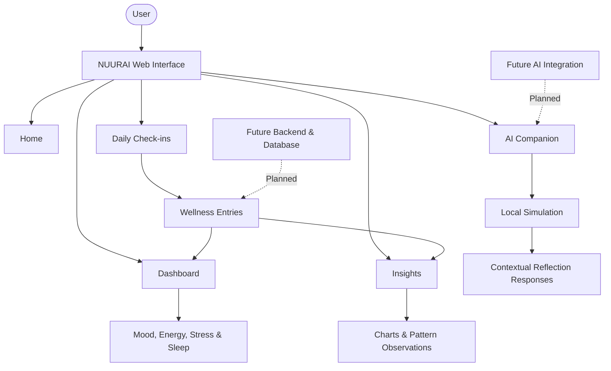

# 🌿 NUURAI
### Your wellbeing, in a little more focus.

**NUURAI** is an AI-powered mental wellness platform designed to help individuals understand their emotional wellbeing through daily check-ins, personal reflections, and meaningful insights.

By bringing together mood tracking, journaling, wellness analytics, and conversational AI, NUURAI encourages users to become more aware of their emotional patterns and everyday habits.

<p align="center">
  <em>Understand your patterns. Reflect on your wellbeing. Grow at your own pace.</em>
</p>

---

## ✦ Preview

### 01. Home — A Space for Self-Reflection

The landing experience introduces NUURAI's approach to mindful check-ins and personal wellbeing.

<p align="center">
  
</p>

### 02. Dashboard — Your Daily Wellbeing at a Glance

A centralized overview of mood, energy, stress, sleep, and weekly wellness patterns.

<p align="center">
  
</p>

### 03. Recent Check-ins — Your Journey, Recorded

A chronological view of previous check-ins, including mood entries, energy levels, stress scores, sleep duration, and personal reflections.

<p align="center">
  
</p>

### 04. Insights — Discover Your Patterns

Visualizes mood, energy, stress, and sleep trends to help users identify recurring patterns and understand their daily experiences.

<p align="center">
  
</p>

### 05. AI Companion — A Space to Reflect

A conversational wellness companion designed to encourage personal reflection and help users explore their recent check-ins. Currently demonstrated through a local simulation prototype.

<p align="center">
  
</p>

---

## ✦ Core Features

| Feature | Description |
|---|---|
| Daily Wellness Check-ins | Record daily moods and personal wellbeing. |
| Mood Tracking | Track emotional states over time. |
| Energy & Stress Monitoring | Observe changes in energy and stress levels. |
| Sleep Tracking | Record sleep duration and perceived quality. |
| Personal Journaling | Capture thoughts, experiences, and reflections. |
| Wellness Dashboard | View important wellness metrics in one place. |
| Weekly Insights | Explore patterns across mood, energy, stress, and sleep. |
| AI Wellness Companion | Interact with a conversational reflection prototype. |

---

## ✦ System Architecture

NUURAI currently follows a frontend-focused architecture built around React components and wellness data visualization.



*Note: The architecture illustrates the current frontend experience and planned integration points. Backend and database connections are not represented as completed functionality.*

---

## ✦ Technology Stack

| Technology | Purpose |
|---|---|
| React | Component-based user interface |
| JavaScript | Application logic |
| CSS | Styling and responsive layouts |
| Vite | Development server and build tooling |

---

## ✦ Getting Started

Follow these steps to run NUURAI locally.

**1. Clone the repository**

```bash
git clone https://github.com/ianusha08/nuurai.git
```

**2. Navigate to the project directory**

```bash
cd nuurai
```

**3. Install dependencies**

```bash
npm install
```

**4. Start the development server**

```bash
npm run dev
```

Open the local URL displayed in your terminal to access the application.

---

## ✦ Development Status

<kbd>Frontend Prototype Completed</kbd> <kbd>Backend Integration Planned</kbd>

NUURAI currently includes its core frontend experience, including the landing page, wellness dashboard, check-in interface, insights visualization, and a locally simulated conversational companion.

Further development will focus on persistent data management, backend integration, and more personalized AI-powered functionality.

## ✦ Roadmap

- [x] Landing page and responsive UI
- [x] Wellness dashboard
- [x] Daily check-in interface
- [x] Mood, energy, stress, and sleep visualizations
- [x] Insights interface
- [x] Conversational companion prototype
- [ ] Backend and database integration
- [ ] Secure user authentication
- [ ] Persistent wellness history
- [ ] AI-powered personalized insights
- [ ] Advanced analytics and pattern detection

---

## ✦ Disclaimer

NUURAI is designed to support personal reflection and emotional awareness. It is not a medical or clinical tool, does not provide diagnoses, and is not a substitute for professional mental healthcare.

---

<div align="center">

### NUURAI 🌿

*Small reflections. Deeper understanding.*

**Designed & Developed by Anusha**

</div>
